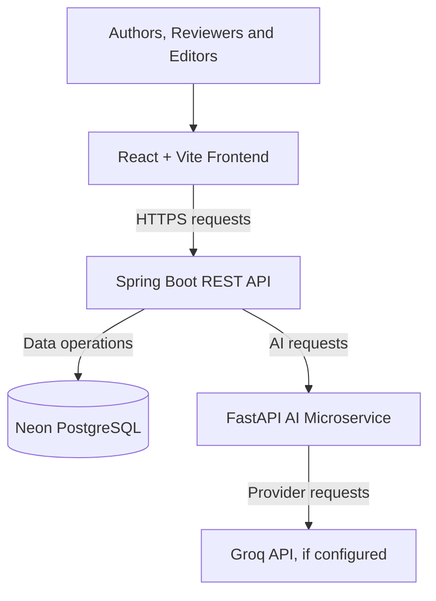

# 🔬 AI-Enabled Research Journal Management System

<p align="center">
  <strong>An intelligent, full-stack platform for research manuscript management and AI-assisted evaluation.</strong>
</p>

<p align="center">
  <a href="https://ai-research-journal-management-system-6p5qu79k1.vercel.app/">
    
  </a>
  <a href="https://github.com/sachinyaganti/AI-Research-Journal-Management-System">
    
  </a>
  <a href="https://ai-service-eaau.onrender.com/docs">
    
  </a>
</p>

<p align="center">
  
  
  
  
  
  
</p>

---

## 🌐 Live Demo

| Service | Link |
|---|---|
| **Live Web Application** | [Launch Application](https://ai-research-journal-management-system-6p5qu79k1.vercel.app/) |
| **GitHub Repository** | [View Source Code](https://github.com/sachinyaganti/AI-Research-Journal-Management-System) |
| **Spring Boot Backend** | [Open Backend Service](https://research-journal-backend-docker.onrender.com) |
| **Backend Health Check** | [Check API Health](https://research-journal-backend-docker.onrender.com/api/health) |
| **FastAPI AI Service** | [Open AI Service](https://ai-service-eaau.onrender.com) |
| **Interactive AI API Docs** | [Explore Swagger UI](https://ai-service-eaau.onrender.com/docs) |

> **Deployment note:** The application is hosted using free-tier cloud services. Initial requests may take longer if a service needs to wake up after inactivity. Individual features may require successful backend, database, and AI-provider configuration.

---

## 📌 Overview

The **AI-Enabled Research Journal Management System** is a full-stack web application developed to organize the research publication lifecycle, from manuscript submission to review, revision, and publication.

Traditional research workflows can involve disconnected tools, manual document handling, repetitive evaluation tasks, and limited visibility into manuscript status. This project brings core manuscript-management operations into a centralized web platform and integrates AI-assisted analysis to support the evaluation process.

The application combines:

- A responsive React-based user interface.
- A Java Spring Boot REST API.
- PostgreSQL for persistent application data.
- A Python FastAPI microservice for AI-related operations.
- Cloud deployment for the frontend, backend, and AI service.

The project demonstrates full-stack application development, REST API integration, authentication, database connectivity, microservice communication, document processing, and cloud deployment.

## 🎯 Objectives

- Digitize manuscript submission and tracking.
- Organize author, reviewer, and editorial workflows.
- Provide a centralized interface for manuscript management.
- Integrate AI-assisted manuscript quality analysis.
- Support content indicators, similarity analysis, and PDF screening.
- Improve workflow transparency and reduce repetitive manual operations.
- Build a maintainable application using separated frontend, backend, and AI-service components.

## ✨ Core Features

### 👥 1. User Authentication and Access

- User registration and login.
- JWT-based authentication for protected backend operations.
- Role-oriented workflows for authors, reviewers, and editorial users.
- Google authentication integration.

### 📝 2. Manuscript Management

- Create and manage manuscript records.
- Enter manuscript titles, abstracts, categories, and keywords.
- Edit manuscript details.
- Upload research-paper PDFs.
- Track manuscript submission and review status.
- Support revision and publication workflows.

### 🤖 3. AI-Assisted Manuscript Analysis

- AI-generated content indicator analysis.
- Manuscript quality assessment.
- Abstract and keyword analysis.
- Identification of potentially missing manuscript sections.
- Writing issue identification.
- Suggestions for manuscript improvement.

### 🔍 4. Similarity Analysis

- Analyze manuscript text for potential similarity.
- Compare submissions against supplied candidate documents where supported.
- Review similarity results and matching information.

Similarity analysis depends on the available comparison corpus and implementation. A similarity score alone does not establish plagiarism.

### 📄 5. PDF Screening

- Submit PDF documents to the AI service.
- Support document-screening operations through a dedicated API.
- Integrate document analysis into the broader manuscript workflow.

### 🔄 6. Review and Editorial Workflow

- Support reviewer assignment and evaluation workflows.
- Facilitate review feedback and manuscript revisions.
- Organize editorial decisions and publication status.

The availability of individual workflow actions depends on the deployed application's current implementation and permissions.

### ☁️ 7. Cloud Deployment

- Frontend deployment on Vercel.
- Spring Boot backend deployment on Render.
- FastAPI AI service deployment on Render.
- PostgreSQL database hosting through Neon.

---

## 🏗️ System Architecture



### Architecture Responsibilities

| Layer | Technology | Responsibility |
|---|---|---|
| Presentation | React, Vite, JavaScript | User interface, navigation, and API consumption |
| Application | Java, Spring Boot | Business logic, REST endpoints, and application workflows |
| Security | Spring Security, JWT | Authentication and authorization |
| Persistence | PostgreSQL, Neon | Persistent storage for application records |
| AI microservice | Python, FastAPI | AI analysis and document-screening endpoints |
| AI provider | Groq API, if configured | External language-model capabilities |
| Frontend hosting | Vercel | Web application deployment |
| Backend hosting | Render | Spring Boot API deployment |
| AI hosting | Render | FastAPI service deployment |

## 🛠️ Technology Stack

### Frontend
- React
- Vite
- JavaScript
- HTML5 and CSS3
- REST API integration

### Backend
- Java 21
- Spring Boot
- Spring Security
- JWT
- Maven

### Database
- PostgreSQL
- Neon

### AI and Document Processing
- Python
- FastAPI
- Uvicorn
- AI-assisted text analysis
- Manuscript similarity analysis
- PDF screening
- Groq integration, where configured

### Tools and Deployment
- Git and GitHub
- Vercel
- Render
- Environment variables
- RESTful services

---

## 📂 Repository Structure

```text
AI-Research-Journal-Management-System/
│
├── frontend/
│   ├── public/
│   ├── src/
│   │   ├── components/
│   │   ├── pages/
│   │   └── ...
│   ├── package.json
│   ├── vite.config.js
│   └── vercel.json
│
├── backend/
│   ├── src/
│   │   ├── main/
│   │   └── test/
│   ├── pom.xml
│   └── ...
│
├── ai-service/
│   ├── Python application modules
│   ├── requirements.txt
│   └── ...
│
└── README.md
```

*This is an illustrative structure. Keep the actual filenames and folders in your repository if they differ.*

---

## 🚀 Local Installation and Setup

### Prerequisites

Install the following:

- Git
- JDK 21
- Apache Maven
- Node.js and npm
- Python compatible with the AI-service dependencies
- PostgreSQL or a Neon database

### Step 1 — Clone the repository

```bash
git clone https://github.com/sachinyaganti/AI-Research-Journal-Management-System.git

cd AI-Research-Journal-Management-System
```

### Step 2 — Configure PostgreSQL

Create a PostgreSQL database or configure an existing Neon database.

Example database name:

```text
research_journal_db
```

Configure the JDBC URL, username, and password through environment variables. Use the exact property names expected by your Spring Boot configuration.

### Step 3 — Start the backend

Open a terminal in the `backend` directory.

Run tests:

```bash
mvn clean test
```

Start the backend:

```bash
mvn spring-boot:run
```

The default local address is:

```text
http://localhost:8080
```

Configure required database settings, JWT signing secrets, CORS origins, and any other mandatory application properties before startup.

### Step 4 — Start the AI service

Open another terminal in the `ai-service` directory.

Create a virtual environment:

```bash
python -m venv .venv
```

Activate it in Windows PowerShell:

```powershell
.\.venv\Scripts\Activate.ps1
```

Install dependencies:

```bash
pip install -r requirements.txt
```

Start the application using the actual module and FastAPI instance name in your repository. For example, if the application instance is named `app` in `main.py`:

```bash
uvicorn main:app --reload --host 127.0.0.1 --port 8000
```

Open the API documentation:

```text
http://127.0.0.1:8000/docs
```

### Step 5 — Start the frontend

Open another terminal in the `frontend` directory.

Install dependencies:

```bash
npm install
```

Create a local `.env` file:

```env
VITE_API_BASE_URL=http://localhost:8080
```

Start Vite:

```bash
npm run dev
```

Open the URL printed in the terminal, typically:

```text
http://localhost:5173
```

### Step 6 — Build and lint the frontend

```bash
npm run build
npm run lint
```

Run the lint command if it is defined in the project's `package.json`.

---

## 🔌 AI Service API Reference

The deployed FastAPI OpenAPI schema lists the following endpoints.

Base URL:

```text
https://ai-service-eaau.onrender.com
```

| Method | Endpoint | Purpose |
|---|---|---|
| `GET` | `/health` | Health check |
| `POST` | `/api/analysis/ai-content` | Analyze AI-generated content indicators |
| `POST` | `/api/analysis/manuscript` | Analyze manuscript quality |
| `POST` | `/api/analysis/similarity` | Perform similarity analysis |
| `POST` | `/api/analysis/screen-pdf` | Submit a PDF for screening |

**Explore the complete request schemas and response formats:** [Open FastAPI Swagger UI](https://ai-service-eaau.onrender.com/docs).

Use the documented request fields when testing endpoints. The PDF screening endpoint accepts a file upload; the JSON endpoints require their respective request bodies.

---

## 🔐 Environment Variables and Security

Production configuration should be managed through the environment settings of each hosting service.

| Variable | Purpose |
|---|---|
| `VITE_API_BASE_URL` | Frontend base URL for the backend API |
| `JWT_SECRET` | JWT signing and validation secret |
| `SPRING_DATASOURCE_URL` | PostgreSQL JDBC connection URL |
| `SPRING_DATASOURCE_USERNAME` | Database username |
| `SPRING_DATASOURCE_PASSWORD` | Database password |
| `GROQ_API_KEY` | Groq authentication, if used by the relevant service |

Confirm the exact variable names against the application's configuration files.

### Security checklist

- Never commit API keys, database passwords, JWT secrets, or `.env` files.
- Use strong, randomly generated JWT secrets.
- Store production credentials in Render, Vercel, or the appropriate provider's environment settings.
- Keep private API keys on the server side.
- Configure CORS for trusted frontend origins.
- Validate uploaded files and restrict file sizes and permitted types.
- Enforce backend authorization for protected operations.
- Protect unpublished research documents and sensitive user information.

---

## 🧪 Testing and Validation

Recommended verification workflow:

1. Run backend tests with Maven.
2. Build the frontend.
3. Confirm the backend health endpoint responds.
4. Confirm the AI service health endpoint responds.
5. Test registration and login.
6. Verify JWT-protected API operations.
7. Create a test manuscript.
8. Upload a sample PDF.
9. Test manuscript analysis and similarity endpoints.
10. Reload frontend routes such as `/register` and `/login`.
11. Verify database persistence and production CORS settings.

A successful deployment or health check confirms service availability, not necessarily the correctness of every feature.

---

## ⚠️ Important Deployment Notes

- The frontend must use the correct production backend URL in `VITE_API_BASE_URL`.
- The backend must permit requests from the deployed Vercel origin.
- The Spring Boot backend and FastAPI service must use the correct environment configuration.
- Client-side routes require suitable Vercel rewrite configuration.
- Free-tier hosting may introduce cold starts or temporary resource constraints.
- AI features that depend on external services require valid provider configuration.
- Test protected endpoints using appropriate credentials rather than exposing tokens in screenshots or logs.

---

## 🔮 Future Enhancements

Potential future improvements include:

- Intelligent reviewer recommendation.
- Advanced manuscript similarity comparison.
- Citation extraction and reference validation.
- Editorial analytics and publication dashboards.
- Email notifications for manuscript status changes.
- Enhanced manuscript version history.
- Audit logging and expanded security controls.
- Automated CI/CD and expanded integration testing.

These items are proposed enhancements and should not be interpreted as completed features unless implemented.

---

## 💡 Learning Outcomes

This project provides practical experience with:

- Full-stack web application development.
- Java and Spring Boot REST API development.
- React-based frontend development.
- Authentication and authorization concepts.
- PostgreSQL integration.
- Python microservices and FastAPI.
- AI API integration.
- PDF upload and document-processing workflows.
- Git version control and cloud deployment.
- Environment configuration and debugging distributed services.

---

## 👨‍💻 Author

**Sachin Yaganti**

GitHub: [@sachinyaganti](https://github.com/sachinyaganti)

Project: [AI-Enabled Research Journal Management System](https://github.com/sachinyaganti/AI-Research-Journal-Management-System)

---

<p align="center">
  <strong>AI-Enabled Research Journal Management System</strong>
  <br/>
  <em>Streamlining research workflows with full-stack engineering and AI-assisted analysis.</em>
</p>
